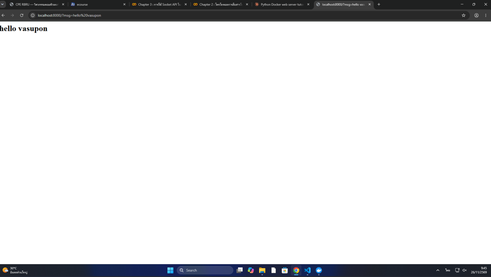
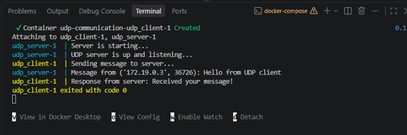

# รายงานผลการทดลอง: Network Programming Lab 2

## ข้อมูลผู้จัดทำ
- ชื่อ-นามสกุล: (ภัทรพล นาคสกุล)
- รหัสนักศึกษา: 6814952012

## แบบฝึกหัด 1: Web Server ด้วย Python และ Docker

## แบบฝึกหัด 2: UDP Client และ Server

